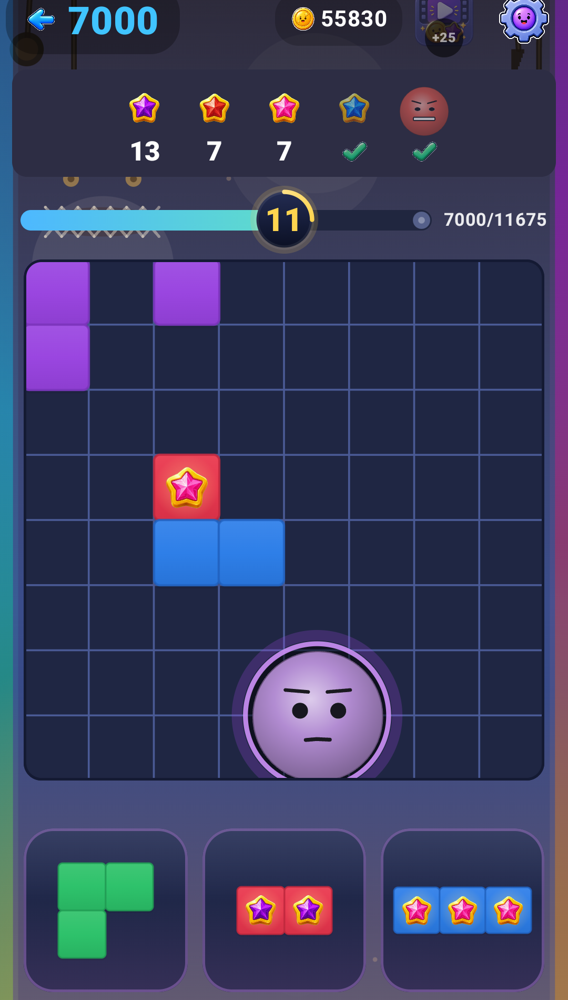
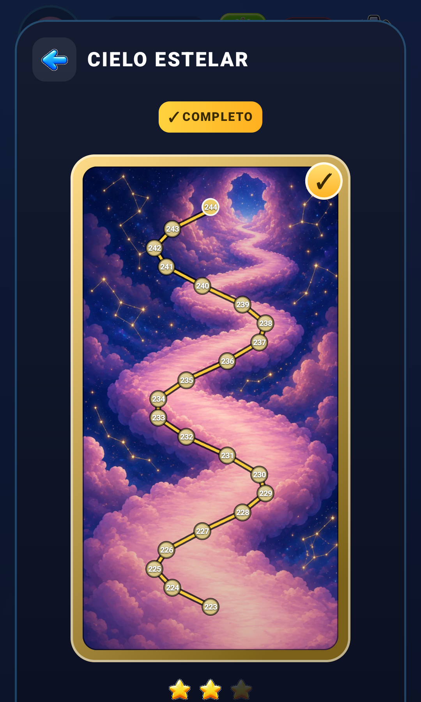
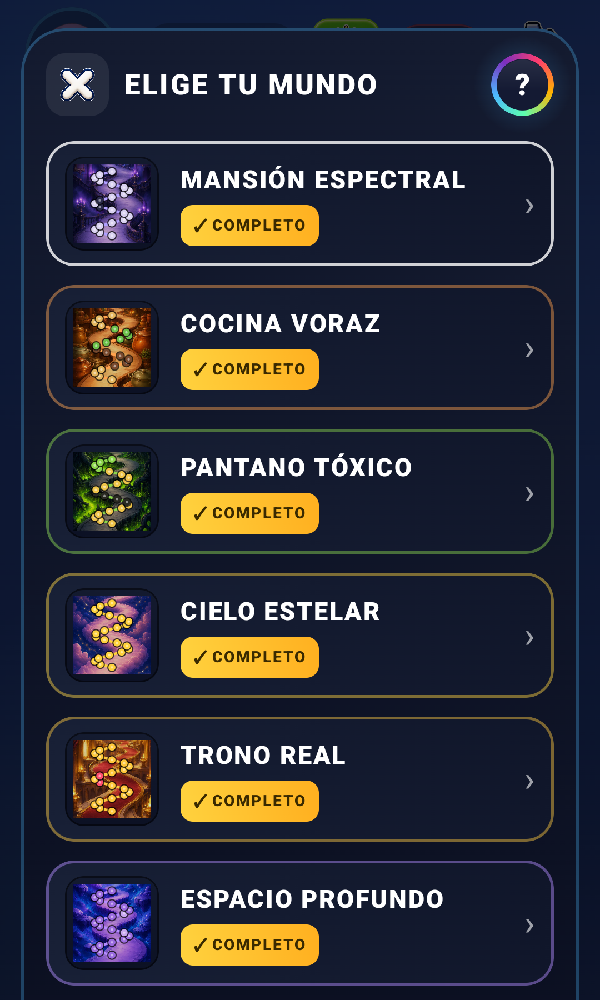
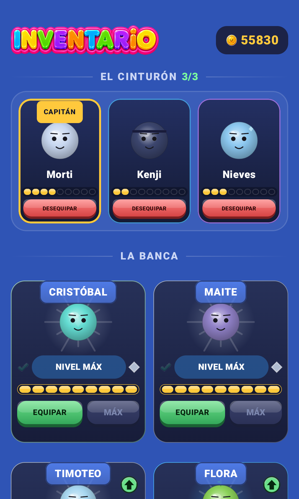

# Teika Fusion 🧩✨

**Juego de puzzle de bloques para Android: rompe líneas y fusiona Teikas hasta conseguir el Mega Teika.**


<p align="center">
  
  
  
  
</p>

## Qué es

Un puzzle de bloques en el que, además de completar filas y columnas, los bloques-Teika se fusionan y evolucionan. El jugador avanza por varios mundos, colecciona compañeros y persigue al Mega Teika.

## Aspectos técnicos destacados

- **UI 100 % en Jetpack Compose**, con animaciones y efectos visuales (partículas, VFX) hechos a medida sobre `Canvas`.
- **Motor del juego desacoplado de la UI**: el modelo (más de 130 clases) es Kotlin puro y se prueba sin el emulador.
- **Batería amplia de pruebas unitarias** sobre las reglas del tablero, las fusiones y el equilibrio.
- **Backend con Firebase**: Auth (Credential Manager / Google Sign-In), Firestore con reglas de seguridad propias, Cloud Functions y Hosting.
- **Monetización**: Google Play Billing y anuncios con recompensa, sin pago para ganar.
- **Persistencia local** con DataStore y audio diseñado para el juego.

## Estructura

```
app/src/main/java/.../model   Motor del juego y reglas (Kotlin puro)
app/src/main/java/.../ui      Pantallas, componentes y efectos en Compose
app/src/test                  Pruebas unitarias
functions/                    Cloud Functions (Node.js)
firestore.rules               Reglas de seguridad
```

## Compilar

1. Clona el repositorio y ábrelo en Android Studio.
2. Crea tu propio proyecto en Firebase y coloca su `google-services.json` en `app/`. No viene incluido por seguridad.
3. Ejecuta `./gradlew assembleDebug`.

## Estado

🟢 En desarrollo activo, preparado para Google Play.

---
Desarrollado por **[Cukiti](https://github.com/Cukiti)**.
